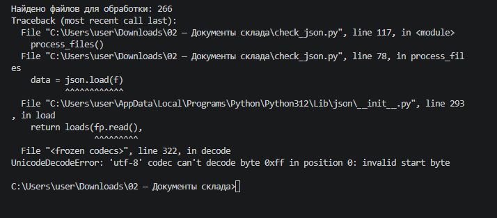
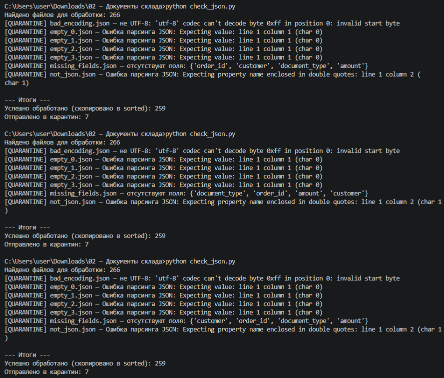
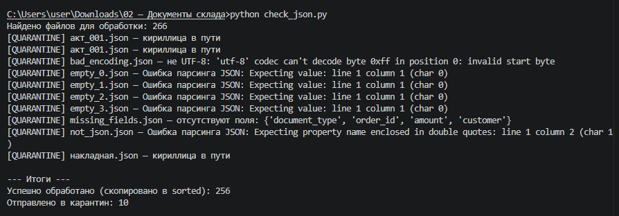
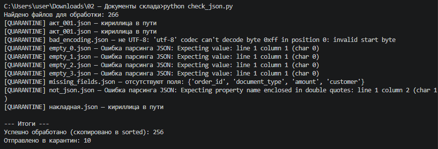
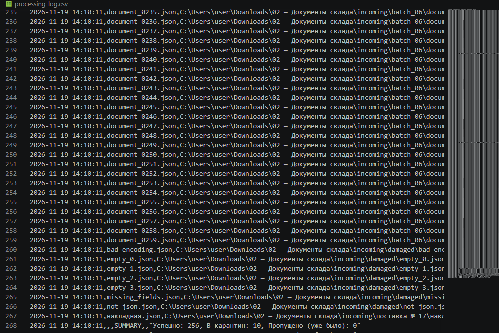
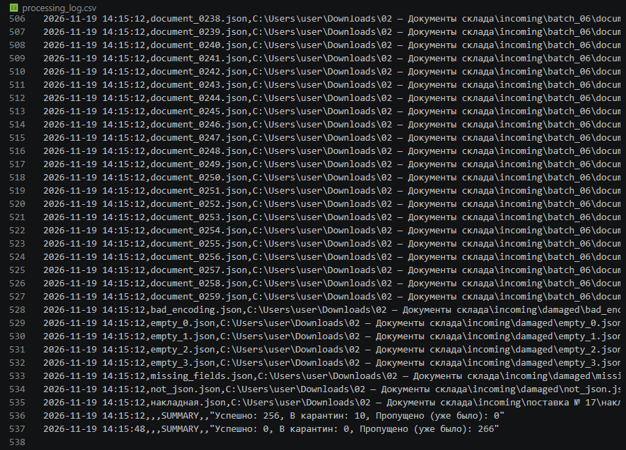

## Создание скрипта

### 1 запуск

Программа упала из-за отсутствия проверки на кодировку файла: ожидается UTF-8, получили на вход другое. Нужно добавить проверку на кодировку и откидывать файлы с неверной кодировкой в карантин.

### 2 запуск

Программа не падает, при повторном запуске файлы не копируются, но:
1. Файлы с одинаковым именем перезаписываются (`акт_001.json`);
2. Нет проверки на кириллические пути (`акт_001.json`, `поставка № 17/накладная.json`).

### 3 запуск

Есть проверка на кириллицу, нужно решить проблему с перезаписыванием файлов.

### 4 запуск

Теперь к файлам с одинаковым названием добавляется счётчик (_1 и т.д).

Однако появилась новая проблема: при повторном запуске файлы дублируются.

### 5 запуск 

Для решения проблемы с дублированием создан processing_log - в нём записываются логи всех действий программы. При повторном запуске программа проверяет наличие изменения файла в логах и не трогает его, если он уже был перемещён.

Проблема в том, что при физическом удалении файлов, если о перемещении есть информация в логах, то программа ничего не делает.

### 6 запуск

Теперь программа проверяет не только логи, но и физическое расположение файла.

## Итог

В целом, на данном этапе программа работает корректно. Вопрос остаётся в оптимизации: данная программа парсит целые json-файлы в память, чтобы читать их. На маленьких файлах это не занимает много памяти, но на больших файлах (гигабайт+) и/или огромном их количестве чтение таких файлов и их копирование будет сжирать много памяти + занимать много времени на перезапись.

Из того, что предложила нейронка:

1. Проводить потоковую проверку вместо парси нга: читать файлы по кусочкам, а не целиком, и прерываться сразу при несоответствии содержания;
2. Вместо csv логов поднять SQLite бдшку и проверять через неё. Поиск по инедксу + не грузит оперативу.